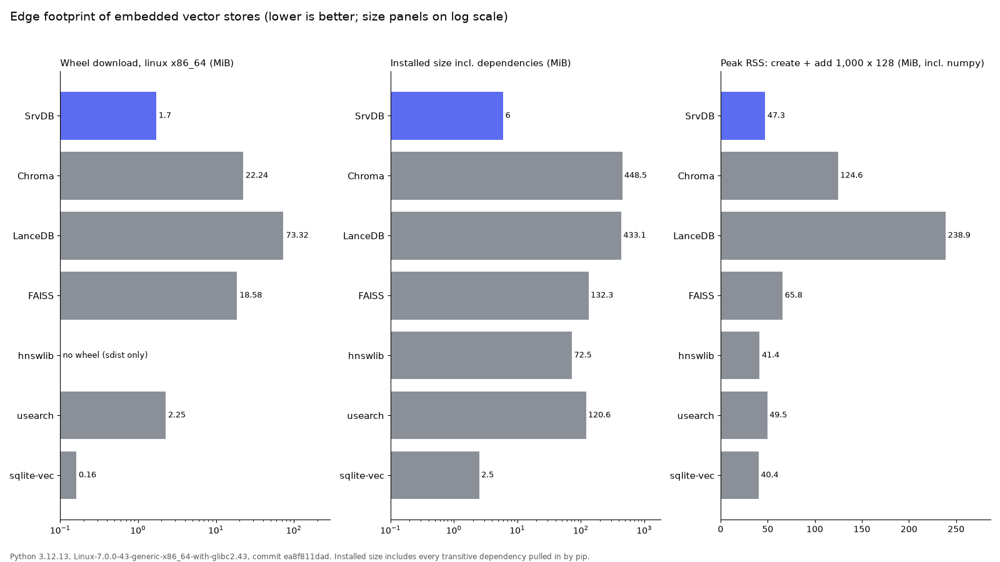

# Edge footprint results

What each embedded vector store costs to ship and run on a small or
offline device. Raw data is in `results.json`, and the method is in the
docstring of `measure.py`.

- Command: `python benchmarks/edge/measure.py`
- Same machine and commit as VecCrash ([../veccrash/REPORT.md](../veccrash/REPORT.md)).
- Offline check: `unshare -rn` (no network namespace), with
  `strace -f -e trace=connect` to count connection attempts.

## Results

| Library | Wheel MiB (Linux x86_64 / aarch64 / macOS arm64 / Windows) | Installed MiB | Extra packages | Import RSS MiB | Create + add 1k RSS MiB | Works offline | Connect attempts | aarch64 wheel |
|---|---|--:|--:|--:|--:|---|--:|---|
| SrvDB 0.4.0 | 1.70 / 1.56 / 1.51 / 1.73 | 6.0 | 0 | 38.6 | 47.3 | yes | 0 | yes |
| sqlite-vec 0.1.9 | 0.16 / 0.15 / 0.16 / 0.28 | 2.5 | 0 | 39.3 | 40.4 | yes | 0 | yes |
| usearch 2.26.6 | 2.25 / 2.16 / 0.43 / 0.33 | 120.6 | 3 | 45.8 | 49.5 | yes | 0 | yes |
| hnswlib 0.8.0 | source only | 72.5 | 1 | 38.8 | 41.4 | yes | 0 | no (needs a C++ compiler) |
| FAISS 1.16.0 | 18.58 / 10.35 / 5.01 / 15.86 | 132.3 | 2 | 58.0 | 65.8 | yes | 0 | yes |
| Chroma 1.5.9 | 22.24 / 21.63 / 20.69 / 22.45 | 448.5 | 83 | 85.5 | 124.6 | yes | 0 | yes |
| LanceDB 0.41.0 | 73.32 / 69.79 / 65.83 / 81.63 | 433.1 | 15 | 182.6 | 238.9 | yes | 0 | yes |

## Findings

1. **SrvDB is among the lightest stores, but it is not the lightest.**
   - It installs in 6.0 MiB with no extra packages.
   - Chroma installs in 448.5 MiB with 83 packages, and LanceDB in
     433.1 MiB with 15.
   - sqlite-vec is smaller to download and install.
   - sqlite-vec and hnswlib use a few MiB less peak RSS.
   - usearch has smaller macOS and Windows wheels.
2. **Combining the two benchmarks:**
   - The stores that passed VecCrash with zero violations were SrvDB,
     Chroma, LanceDB and sqlite-vec.
   - Of those, only SrvDB and sqlite-vec install in under 10 MiB with
     no extra packages.
   - SrvDB adds approximate-search indexes and quantization (HNSW, IVF,
     SQ8 and RaBitQ) that sqlite-vec does not provide.
3. **Every library ran fully offline and made no network connections.**
   Chroma's `anonymized_telemetry` setting defaults to on, but in 1.5.9
   its telemetry call does nothing, which matches the zero connection
   attempts we measured.
4. **hnswlib ships no prebuilt wheels.** Installing it on an ARM device
   needs a C++ toolchain.
5. **SrvDB's aarch64 support is tested in CI** by the `test-rust-arm64`
   job (NEON kernels, `ubuntu-24.04-arm`) and the `wheel-arm64` job in
   `.github/workflows/ci.yml`.

## Limits

- Peak RSS is for a 1,000-vector workload, so it measures fixed overhead,
  not scaling.
- All measurements were taken on x86_64. The aarch64 figures are wheel
  sizes and CI results, not runs on an ARM device.
