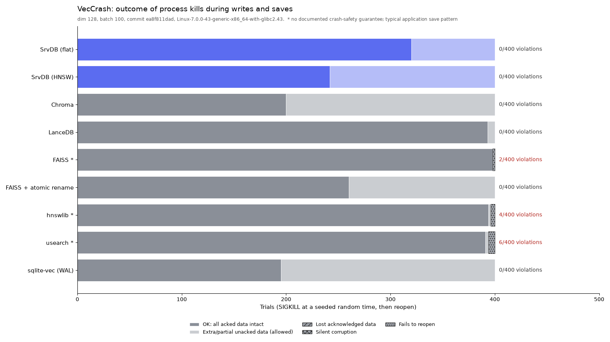

# VecCrash results

Crash consistency of embedded vector stores under `kill -9`. The method,
fairness rules and reproduction steps are in [README.md](README.md). Raw
data is in `results.json`.

- Command: `python benchmarks/veccrash/run.py --trials 400 --workers 4 --batches 20`
- Commit `ea8f811`; AMD Ryzen 5 3550H, 8 logical CPUs, 16 GiB RAM; Linux
  7.0.0-43, ext3; Python 3.12.13.
- 400 trials per library; dimension 128, 100 vectors per batch, 20 batches
  per trial, seed 20261126.

## Outcomes

| Library (version) | OK | Extra batch | Lost acked | Silent corruption | Won't open | Violation rate, 95% Wilson CI |
|---|--:|--:|--:|--:|--:|---|
| SrvDB 0.4.0, flat | 320 | 80 | 0 | 0 | 0 | 0 – 0.95% |
| SrvDB 0.4.0, HNSW | 242 | 158 | 0 | 0 | 0 | 0 – 0.95% |
| Chroma 1.5.9 | 200 | 200 | 0 | 0 | 0 | 0 – 0.95% |
| LanceDB 0.41.0 | 393 | 7 | 0 | 0 | 0 | 0 – 0.95% |
| sqlite-vec 0.1.9 (SQLite 3.50.4, WAL) | 195 | 205 | 0 | 0 | 0 | 0 – 0.95% |
| FAISS 1.16.0 + temp/fsync/rename | 260 | 140 | 0 | 0 | 0 | 0 – 0.95% |
| FAISS 1.16.0, `write_index` * | 398 | 0 | 0 | 0 | 2 | 0.14 – 1.8% |
| hnswlib 0.8.0, `save_index` * | 394 | 2 | 0 | 0 | 4 | 0.4 – 2.5% |
| usearch 2.26.6, `save` * | 391 | 3 | 0 | 0 | 6 | 0.7 – 3.2% |

\* No documented crash-safety guarantee. The test uses the typical save
pattern from each library's docs.

"Extra batch" means one whole batch was saved, but the process was killed
before the test logged the acknowledgement. The batch is complete, so this
is not a violation.

## Findings

1. **Every store with a transactional or atomic save kept all acknowledged
   data.** That covers SrvDB, Chroma, LanceDB and sqlite-vec. None had
   lost, silently corrupted or unopenable data in 400 trials. SrvDB is in
   this group; it is not alone in it.
2. **Libraries that overwrite their index file in place can lose
   everything.** FAISS, hnswlib and usearch each left a truncated file
   that would not reopen, in 2, 4 and 6 of 400 trials. The errors were:
   - FAISS: `read error ... 262062 != 768000`
   - hnswlib: `Index seems to be corrupted or unsupported`
   - usearch: `Not a dense USearch index!` and `End of file reached!`

   The application loses every earlier save, not only the last batch.
3. **The fix belongs to the application.** Wrapping FAISS's write in
   write-to-temp, fsync and atomic rename removed every failure (0/400).
4. **Silent corruption was never observed.** Every failure was a store
   that refused to open, never one that returned wrong data.

## Limits

- **Process crashes only.** `kill -9` leaves the OS page cache intact, so
  a missing fsync goes undetected. Power-loss testing needs root or a VM
  and is future work.
- **Kills rarely land inside a save,** because saves are a short part of
  each run. 0/400 bounds the failure rate below about 1%; it does not
  prove it is zero.
- **SrvDB 0.4 has no public call to read a vector back.** Its intactness
  check uses metadata plus an exact self-search (score above 0.99999),
  which is conservative against SrvDB under HNSW.
- **The machine was shared with another benchmark** (load average about
  16). This affects timing only, and no timing is reported.
